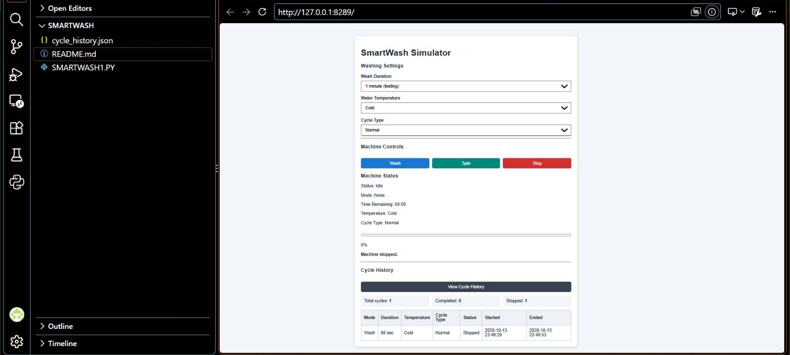

# SmartWash — Washing Machine Simulator

A Python-based web application that simulates a washing machine through an interactive browser interface. SmartWash demonstrates basic backend development, frontend interaction, HTTP communication, timer logic, and JSON file handling.

## Features

- **Wash and Spin:** Start a simulated washing or spinning cycle.
- **Stop Control:** Stop a running cycle.
- **Customisable Settings:** Select wash duration, water temperature, and cycle type.
- **Live Status Updates:** View machine status, selected mode, and remaining time.
- **Progress Tracking:** Monitor cycle progress through a progress bar.
- **Cycle History:** View saved completed and stopped cycles.
- **Cycle Statistics:** See total, completed, and stopped cycle counts.
- **Local Data Storage:** Save cycle history in a JSON file.
- **Responsive Interface:** Use the interface on desktop and smaller screens.

## Technologies Used

| Technology | Purpose |
|---|---|
| Python | Backend logic and HTTP server |
| HTML5 | Webpage structure |
| CSS3 | Styling and responsive layout |
| JavaScript | Interactive controls and frontend-backend communication |
| JSON | Data exchange and local cycle-history storage |

The project uses Python's built-in `http.server`, `json`, `time`, `datetime`, and `pathlib` modules. No external Python packages are required for the current version.

## How It Works

1. The user selects the washing settings in the browser.
2. JavaScript sends the selected action and settings to the Python backend.
3. The backend updates the machine state and manages the cycle timer.
4. The browser periodically requests updated status information.
5. Completed and stopped cycles are saved to `cycle_history.json`.
6. The cycle-history interface retrieves and displays the saved records.

## Project Structure

```text
SmartWash/
├── SMARTWASH1.PY
├── cycle_history.json   # Created when cycle history is saved
└── README.md
```

## Requirements

- Python 3.10 or newer recommended
- A modern web browser
- Visual Studio Code or another code editor (optional)

## Installation and Setup

### 1. Clone the repository

Replace `YOUR-USERNAME` with your GitHub username.

```bash
git clone https://github.com/prachisahay03/SMARTWASH1.git
cd SMARTWASH1
```

Alternatively, download the repository as a ZIP file and extract it.

### 2. Run the application

On Windows, open a terminal in the project folder and run:

```bash
py SMARTWASH1.PY
```

You should see a message similar to:

```text
SMARTWASH1 running at http://127.0.0.1:8289/
```

### 3. Open the application

Open the following address in your browser:

http://127.0.0.1:8289/

Keep the Python terminal running while you use the application.

To stop the server, press `Ctrl + C` in the terminal.

## Available Settings

### Wash duration
- 1 minute (testing)
- 3 minutes (testing)
- 5 minutes

### Water temperature
- Cold
- 30°C
- 40°C

### Cycle type
- Quick
- Normal
- Heavy

The Spin cycle currently uses a fixed duration of 120 seconds.

## Cycle History

The application stores cycle details such as:
- Mode
- Duration
- Water temperature
- Cycle type
- Final status
- Start time
- End time

The history is saved locally in `cycle_history.json`, next to the Python program. The file is created when the first cycle is recorded.

## Concepts Demonstrated

- Python dictionaries and functions
- HTTP server and request handling
- GET and POST requests
- Frontend-backend integration
- JavaScript asynchronous functions
- Timer and progress calculations
- JSON file reading and writing
- Basic input validation
- Error handling
- Responsive web design

## Limitations

- This is a software simulator, not a physical washing machine controller.
- Cycle history is stored locally in a JSON file.
- The current version uses a single shared machine state and is intended for local use.
- No user authentication or database integration is included.

## Future Improvements

- Add a database such as SQLite or MySQL.
- Add automated tests.
- Improve accessibility and user-interface design.
- Add additional cycle options and configuration.
- Explore hardware integration with appropriate controllers and safety mechanisms.

## Learning Objective

SmartWash was developed as a learning project to practise Python programming and understand how a web frontend communicates with a backend, manages application state, and stores data.

## Author

**Prachi Sahay**

BSc Information Technology Undergraduate

GitHub: https://github.com/-prachisahay03

## Application Screenshot



---

*SmartWash is an educational simulation project. It does not operate or control real washing-machine hardware.*
